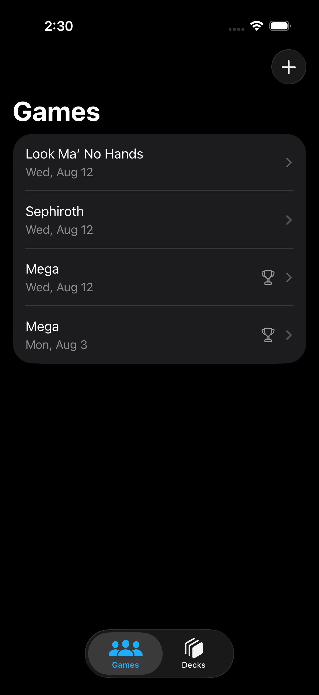
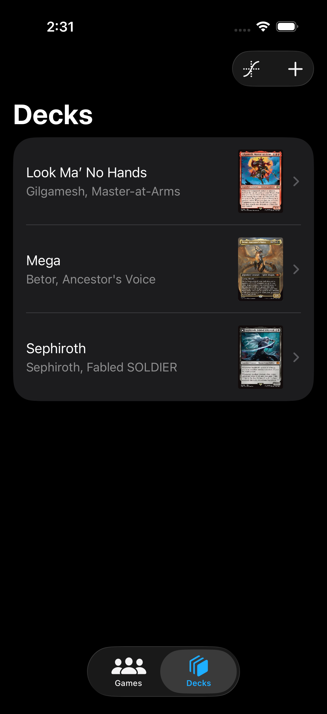
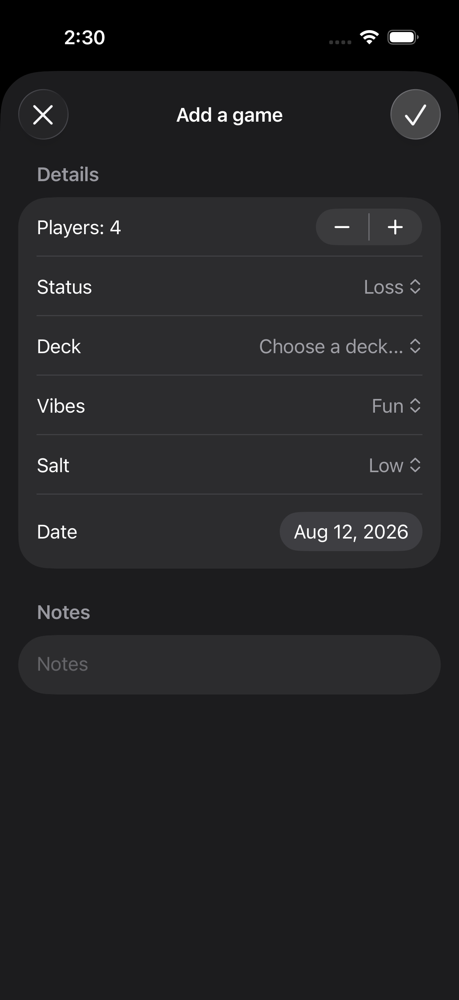
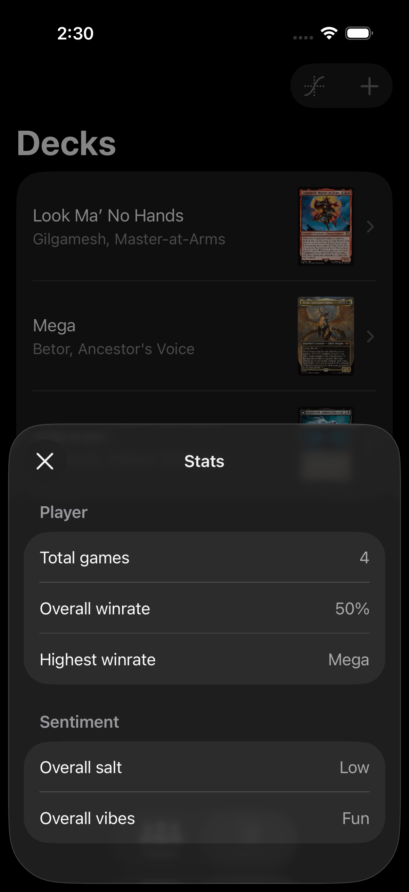

#  Thopter

## What is Thopter
Thopter is a Commander deck stat tracker. Rather than tracking every detail imaginable, Thoper is there to help answer a few simple questions:
Is your deck winning too much? 
Is your pod salty? 
What are the vibes?

## Features
- Simple design w/easy to enter deck/games.
- Player stats to see if things are getting too salty or if a deck is winning too often

## What technology does Thopter showcase
- Approachable concurrency w/default @MainActor isolation
- Modern async/await
- SwiftData to persist games and decks

## Screenshots
     
     
